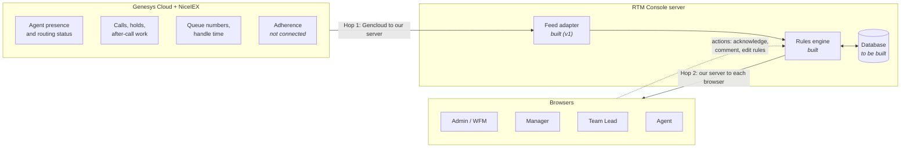
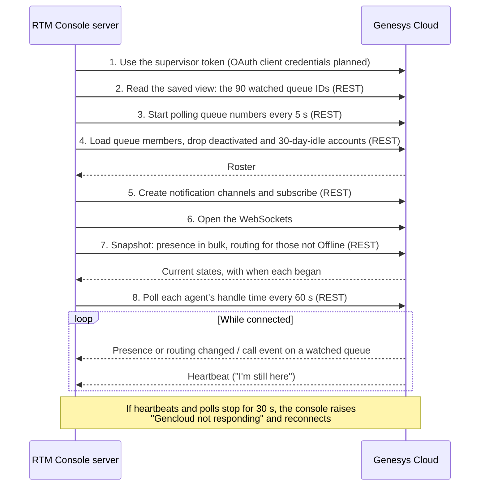
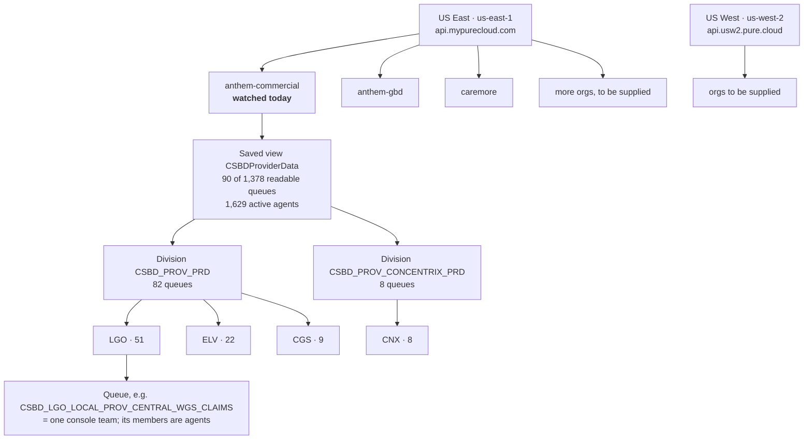
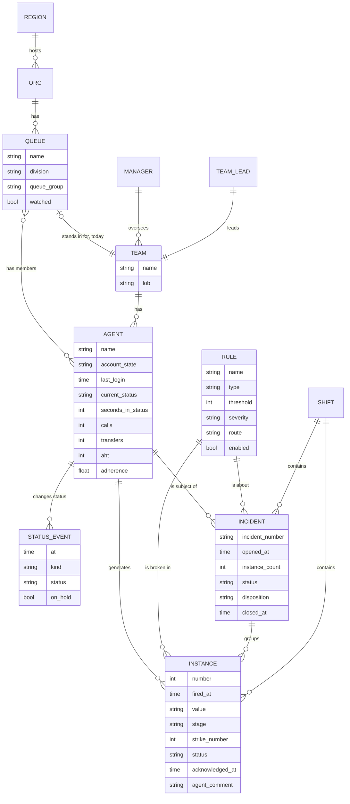
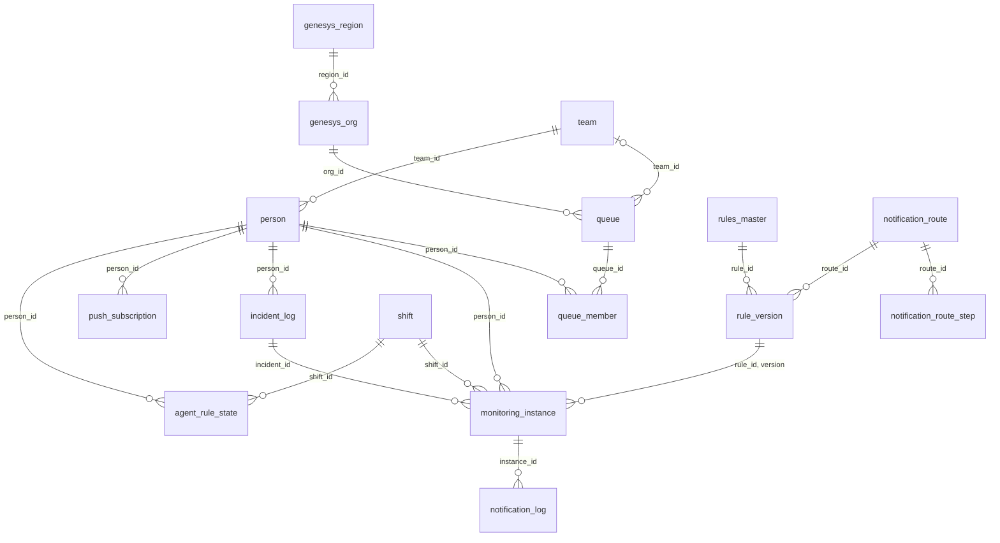
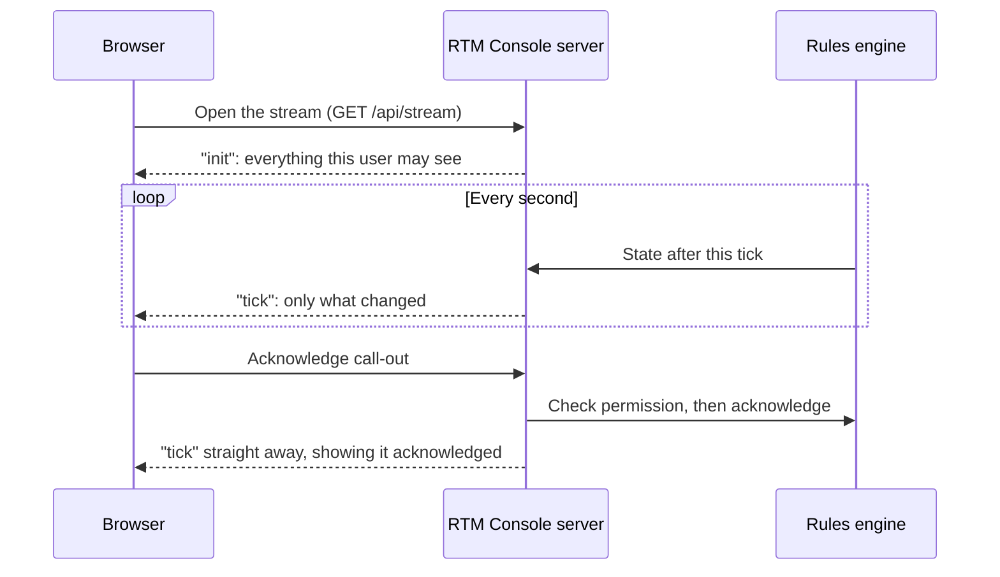

# RTM Console · Data Architecture

How data enters the console, what the console does with it, where it should be stored, and how the pieces relate.

| | |
| --- | --- |
| **Audience** | Backend developers, and stakeholders reviewing the design |
| **Status** | Proposal for review. PostgreSQL is recommended (see [Section 7](#7-choosing-the-database)); nothing is stored yet |
| **Reflects** | The application as it is on `main`, 12 October 2026 |
| **Owner** | BITS Automation Team |

---

## Contents

1. [Summary](#1-summary)
2. [The big picture](#2-the-big-picture)
3. [Gencloud API and WebSockets, explained](#3-gencloud-api-and-websockets-explained)
4. [The data model](#4-the-data-model)
5. [Where each field comes from](#5-where-each-field-comes-from)
6. [What needs to be stored](#6-what-needs-to-be-stored)
7. [Choosing the database](#7-choosing-the-database)
8. [Proposed schema](#8-proposed-schema)
9. [How the browser talks to the server](#9-how-the-browser-talks-to-the-server)
10. [Decisions needed](#10-decisions-needed)
11. [Glossary](#11-glossary)

---

## 1. Summary

RTM Console watches what agents are doing, checks it against rules, and escalates repeat breaches. It now runs on **live Genesys Cloud data for one org** (`anthem-commercial`, 90 watched queues), or on the simulator or an imported day. It still **stores nothing**: everything is held in memory and lost when the server restarts.

Three things were missing to go live. One is built; this document is the brief for the other two.

| # | What is missing | In one line | Status |
| --- | --- | --- | --- |
| 1 | **A live data feed** | Connect to Genesys Cloud ("Gencloud") so real agent statuses arrive as they happen | **Built (v1)** for one org, on a pasted supervisor token |
| 2 | **A database** | Save rules, call-outs and incidents so they survive a restart and can be reported on | Designed (20 tables), not built |
| 3 | **Real identities** | Link everything by ID instead of by name, and take the signed-in user from SSO | Not built |

> [!IMPORTANT]
> **The short answer on the database:** the data is relational. Orgs have queues, queues have agents, agents generate call-outs, call-outs roll up into incidents, and every screen filters and counts across those links. **We recommend PostgreSQL.** MongoDB can work, but it would mean doing by hand what a relational database does for free. The reasoning is in [Section 7](#7-choosing-the-database).

---

## 2. The big picture

Data makes two separate journeys. Keeping them apart is the key to understanding the system.



| | Hop 1 | Hop 2 |
| --- | --- | --- |
| **From → to** | Genesys Cloud → our server | Our server → each user's browser |
| **Carries** | Raw facts: "Joshua went into ACW at 10:14:05" | The console's view: agent grid, call-outs, incidents, scoped to what that user may see |
| **Status** | **Built (v1)** in `lib/feed/GencloudFeed.ts` and `lib/feed/gencloud/` | **Built and working** |
| **Who builds it** | Next: OAuth client credentials, more orgs | Done; may be revisited |

Between the two hops sits the **rules engine**. It is the only part that makes decisions. It keeps a clock (US Eastern), tracks how long each agent has been in their current status, checks 14 rules every second, counts strikes, and decides who gets told. It is built and unit tested, and it does not care where its data comes from.

---

## 3. Gencloud API and WebSockets, explained

These two terms come up together and are easy to mix up. They describe **Hop 1**: how our server gets data out of Genesys.

### Two ways to get data from Genesys

| | REST API | Notifications (WebSocket) |
| --- | --- | --- |
| **How it works** | We ask a question, Genesys answers. One request, one response | We open a connection once and Genesys **pushes** changes to us as they happen |
| **Like** | Phoning to ask "what's the status now?" | Staying on the line and being told the moment something changes |
| **Good for** | Things that rarely change, a starting snapshot, or totals | Things that change constantly |
| **We use it for** | Watched queues, queue members, the first snapshot of everyone's status, queue numbers, handle time | Every status change, call end, transfer, hold and after-call work, live |

We need **both**. REST loads the starting picture and the totals; the WebSocket keeps agent states current. Polling REST alone every few seconds for 1,600 agents would be slow, would hit Genesys rate limits, and would miss short events such as a 12-second call.

### How the live connection works



Requests are paced at four a second (one a second for a minute after any 429), because the supervisor whose token this is shares the same rate limit. Loading the roster takes about 2.5 minutes; queue numbers start within seconds.

### What we subscribe to and poll

| We need | Genesys source | How often | Feeds |
| --- | --- | --- | --- |
| Watched queues | `GET /api/v2/analytics/reporting/settings/viewconfigurations/{id}` (`RTM_VIEW_CONFIG_ID`) | At connect | Which queues and agents to watch |
| Queue names | `GET /api/v2/routing/queues/divisionviews` | At connect | Team names (one per queue, today) |
| Queue members | `GET /api/v2/routing/queues/{id}/members?expand=dateLastLogin` | At connect | The roster |
| Current presence | `GET /api/v2/users/presences/purecloud/bulk` (50 a request) | At connect | Starting state and time in state |
| Current routing | `GET /api/v2/users?expand=routingStatus`, only for agents not Offline | At connect | Starting state and time in state |
| Agent presence (Available, Break, Meal, Offline…) | Topic `v2.users.{id}.presence` | Every change | Agent state and the timer rules |
| Routing status (Interacting, Idle, Not Responding…) | Topic `v2.users.{id}.routingStatus` | Every change | On Call / Outbound / Available |
| Call end, transfer, hold, after-call work | Topic `v2.routing.queues.{id}.conversations`, one per watched queue | Every change | ACW, Long hold, Short call, Transfer rate |
| Queue numbers (waiting, service level, ASA, abandon) | `POST /api/v2/analytics/queues/observations/query` and `/conversations/aggregates/query` | Every 5 s | Queue tiles and queue rules |
| Handle time per agent | `/conversations/aggregates/query` grouped by `userId`, `tHandle` | Every 60 s | Each agent's AHT |
| Adherence | **NiceIEX**, not Genesys | Not connected | Adherence breach rule |
| Team Lead, Manager, LOB | Not chosen | Not connected | Role scoping |

The queue topic replaced the per-agent `v2.users.{id}.conversations` topic: 90 topics instead of about 1,600, and it was observed live on 8 Oct 2026 to carry every field needed. Routing stays `INTERACTING` through after-call work, so ACW is visible **only** on this topic.

### Checked with the live tenant

| Point | What we found | Still open |
| --- | --- | --- |
| **Topic limits** | 1,000 topics per channel. The console holds two per agent plus one per watched queue: about 3,350 topics, 5 channels | The tenant's channel limit per user |
| **Sign-in** | A supervisor's token, pasted on `/admin/token`. It has no fixed expiry and lapses when idle, revoked or signed out | OAuth client credentials (`GENCLOUD_CLIENT_ID`, `GENCLOUD_CLIENT_SECRET` are read but not used) |
| **Permissions** | The token holds `analytics:conversationDetail:view` and `analytics:conversationAggregate:view` | Whether all 90 queues sit in the token's 7 divisions |
| **Division reach** | The token reads members of 1,378 of the org's 3,336 queues; the rest by name only | A token with wider division access, to watch more |
| **Channel lifetime** | A fresh channel is created on every reconnect | – |
| **Org structure** | Not in the watched view: queues stand in for teams, with no Team Lead or Manager | Decision 3 |
| **Adherence and schedules** | Not available from Genesys | Decision 4 |

### Regions, organizations, queue groups and queues

The **org** is the unit the console connects to: each has its own token, users, queues and rate limit. Its **region** only decides which hosts the calls go to.



A **queue group** is the family a queue's name puts it in: the second and third parts of `CSBD_<group>_<subgroup>_…`. It is not a Genesys object and not yet a console level: the console shows each queue as a team and sums all 90 into one set of floor numbers. Counted on 9 Oct 2026:

| Group | Subgroups (queues) | Division | Queues |
| --- | --- | --- | --- |
| LGO | LOCAL (24), ACA (14), NAT (8), HOST (5) | CSBD_PROV_PRD | 51 |
| ELV | PROV (12, all `_BOT_AGENT`), NAT (8), LOCAL (2) | CSBD_PROV_PRD | 22 |
| CGS | PROV (9) | CSBD_PROV_PRD | 9 |
| CNX | HOST (5), LOCAL (3) | CSBD_PROV_CONCENTRIX_PRD | 8 |

- The rest of a name narrows it further: region (CENTRAL, EAST, NY), platform (WGS, FACETS, CS90), PAR or NONPAR, BENEFITS or CLAIMS.
- A membership is one person on one queue. The view's 44,386 memberships are 2,743 accounts, about 16 queues each, often across groups. 1,039 are deactivated and 116 have not logged in for 30 days; both are left off the roster, leaving 1,629.
- The view's queue list is edited in Genesys; the console picks up a change at its next restart. `node tools/list-queues.mjs` lists every readable queue with its ID.

### Where "WebSockets" might also mean Hop 2

The other place a WebSocket could appear is between our server and the browser. Today that hop uses **Server-Sent Events (SSE)**, a simpler one-way push that suits this job: the server pushes updates, and the browser sends actions as ordinary requests. It works and does not need to change. Switching it to a WebSocket is optional and discussed in [Section 9](#9-how-the-browser-talks-to-the-server).

---

## 4. The data model

Five things matter, plus where they come from in Genesys and the people who sign in.



### What each one is

| Entity | Plain meaning | Created by | Changes |
| --- | --- | --- | --- |
| **Region** | Where an org's Genesys hosts are (US East, US West) | Configuration | Rarely |
| **Org** | One Genesys organization: its own token, users, queues and rate limit | Configuration | Rarely |
| **Queue** | A Genesys queue; the watched ones decide who is on the floor | The saved view, at connect | When the view is edited |
| **Team** | A group of agents with one Team Lead and one Manager. **Today each watched queue is a team, with no lead** | Org data (source not chosen) | Rarely |
| **Agent** | A person on the floor, with their live status and today's counters | Queue members, then the feed | Every second |
| **Rule** | One thing the console watches for, with its threshold and who to tell | Seeded with 14 defaults | When an Admin or Manager edits it |
| **Instance** | One call-out: a rule fired for an agent (or for the queue) at a moment | The rules engine | When acknowledged or commented on |
| **Incident** | An investigation, opened at an agent's third strike on one rule | The rules engine | Open → Investigating → Closed |
| **Status event** | A raw fact from the feed: a status change, call end, hold or after-call work | The feed | Never (append-only) |
| **Shift** | One working day's worth of data | To be designed (decision 7) | Once at start, once at end |

### How they connect, in words

- A **Region** hosts several **Orgs**. An org has many **Queues**; a saved view picks the watched ones.
- An **Agent** is a member of many queues (about 16). Today the console puts each agent on the first watched queue it finds them in and treats that queue as their **Team**.
- A **Manager** oversees several **Teams**. A **Team Lead** leads exactly one. This is what decides who can see what, and it has no live source yet.
- When an agent breaks a **Rule**, the engine writes an **Instance**. Each instance records the strike number for that agent and that rule.
- On the full ladder, strike 1 is a private nudge to the agent, strike 2 goes to the Team Lead, and strike 3 and later go to Ops and open or update an **Incident**.
- An **Incident** belongs to one agent and one rule. There is at most one open incident per agent per rule; later strikes add to its count.
- Queue-level rules (backlog, service level, abandon) and the feed rule write instances against **the floor**, not an agent, and never open incidents.

> [!CAUTION]
> **Everything is currently linked by name, not by ID.** An instance points at its agent by the agent's name, at its rule by the rule's name, and at its team by the team's name. That is fine in memory but will fail in a database as soon as two agents share a name or someone is renamed. **Introducing real IDs is the first schema task**, and the Genesys user ID is the natural key for agents. The feed already holds it (`idToName` in `GencloudFeed.ts`); the engine does not.

---

## 5. Where each field comes from

The full definitions are in [`lib/types.ts`](../lib/types.ts). This section maps each field to its source so the gaps are visible.

**Key:** ✅ real, from the source · ⚙️ worked out by the console · ⚠️ shown, but not real yet · ❓ no source yet

### Agent

| Field | Meaning | Source | |
| --- | --- | --- | --- |
| `id` | Unique identifier | Genesys user ID | ⚠️ today a row number; the feed keeps the Genesys ID |
| `name` | Display name | Genesys queue member | ✅ |
| `team` | Team membership | The first watched queue the agent is on | ⚠️ a queue, not a team |
| `state` | One of seven console states | Genesys presence + routing + call events, mapped (below) | ✅ |
| `stTime` | Seconds in the current state | At connect, Genesys's own start time (from Eastern midnight at most, except calls); then the engine timer | ✅ / ⚙️ |
| `onHold`, `holdTime` | On hold, and for how long | `held` and `startHoldTime` on the queue conversation topic; engine timer | ✅ / ⚙️ |
| `calls`, `shortCalls`, `transfers` | Today's counters | Counted by the engine from call ends on the queue topic | ⚠️ only since the last restart |
| `aht` | Average handle time, seconds | Genesys `tHandle` per agent since Eastern midnight (talk, hold, ACW); an estimate until the agent's first handled call | ✅ |
| `adh` | Shift adherence % | NiceIEX | ❓ a default 96% |
| `strikes` | Strike count per rule | Engine | ⚙️ since the last restart |

### The seven console states

Genesys has many more statuses than the console. `mapGenesysState()` and `consoleState()` in `lib/feed/gencloud/state.ts` map them down to seven. The first matching row wins:

| Genesys presence, routing or call | Console state |
| --- | --- |
| Presence *Offline* | Offline |
| After-call work pending, no call connected | ACW |
| Routing *INTERACTING* (an ACD call) | On Call |
| Routing *COMMUNICATING* (a non-ACD call, such as a callback) | Outbound |
| Routing *IDLE*, or presence *On Queue* | Available |
| Presence *Break* or *Meal* | Aux Break |
| Routing *NOT_RESPONDING*, or any other presence: *Available* off queue, *Busy*, *Away*, *Meeting*, *Training*, *Idle* | Aux Personal |

> [!NOTE]
> File imports still use `guessState()` in `lib/csv/parse.ts`, a looser match on status names. Treating *Meeting* and *Training* as Aux Personal is a choice pending WFM (decision 5): until schedules arrive, a scheduled meeting can raise Unscheduled Aux.

### Queue numbers

Each is summed or weighted by calls across the 90 watched queues, since Eastern midnight, into one set for the floor.

| Field | Meaning | Source | |
| --- | --- | --- | --- |
| `cq` | Calls waiting now | Queue observations, `oWaiting` | ✅ real-time only, not in interval exports |
| `sl` | Service level % | Conversation aggregates, `oServiceLevel` (within target ÷ counted); `null` until a call is counted | ✅ |
| `asa` | Average speed of answer, seconds | Conversation aggregates, `tAnswered` sum ÷ count | ✅ |
| `ab` | Abandon % | Conversation aggregates, `tAbandon` ÷ `nOffered` | ✅ |

The console treats the floor as **one queue**. Whether it should show one set of numbers per queue group (Section 3) is an open decision ([Section 10](#10-decisions-needed)).

### Rule, Instance, Incident

These are produced and owned by the console; nothing comes from Genesys.

| Entity | Fields | Notes |
| --- | --- | --- |
| **Rule** | `id`, `name`, `type`, `cond`, `thr`, `unit`, `sev`, `route`, `on` | 14 defaults. Only threshold, severity, route and on/off are editable |
| **Instance** | `n`, `t`, `agent`, `isFloor`, `team`, `rule`, `ruleId`, `val`, `stage`, `sev`, `status`, `ackT`, `strikes`, `inc`, `cmt`, `cond`, `rev` | `cond` is a snapshot of the rule's threshold at the moment it fired, so later rule edits do not rewrite history |
| **Incident** | `inc`, `t`, `agent`, `team`, `rule`, `ruleId`, `instances`, `status`, `disposition`, `closedT` | Numbered `INC-2026-NNNN` |

Times (`t`, `ackT`, `closedT`) are **seconds since midnight US Eastern** (`lib/floorTime.ts`, `RTM_TIME_ZONE`), with no date. That must become a full timestamp once data is stored across days.

### The 14 rules

Defaults from `defaultRules()` in `lib/engine/rules.ts`. A duration rule fires once per state episode and re-arms when the state changes or the value drops back under; Adherence breach and Transfer rate fire once per shift. Offline agents are checked only by Prolonged offline.

| Rule | Type | Fires when (default) | Severity | Route | On live data |
| --- | --- | --- | --- | --- | --- |
| Extended ACW | Duration | ACW longer than 120 s | Warn | Nudge → TL → Ops | Works |
| Unscheduled Aux | Duration | Aux Personal longer than 300 s | Warn | Nudge → TL → Ops | Works; Meeting and Training count |
| Overbreak | Duration | Aux Break longer than 900 s | Warn | Nudge → TL → Ops | Works; one limit, no schedule |
| Prolonged offline | Duration | Offline longer than 600 s | Critical | TL first → Ops | Fires at every logoff: no schedule |
| Long call | Duration | On Call longer than 900 s | Critical | TL first → Ops | Works |
| Long hold | Duration | On hold longer than 120 s | Warn | Nudge → TL → Ops | Works |
| Outbound call | Duration | Outbound longer than 600 s | Warn | TL first → Ops | Works |
| Short call | Event | A call ends in under 30 s | Warn | Nudge → TL → Ops | Works, since the last restart |
| Adherence breach | Duration | Adherence below 90% | Warn | Nudge → TL → Ops | Never fires: no adherence source |
| Transfer rate | Ratio | Transfers above 25% of calls, at 5 calls or more | Warn | Nudge → TL → Ops | Works, since the last restart |
| Queue backlog | Queue | More than 8 calls waiting | Critical | TL first | Works |
| Service level | Queue | Service level below 80% | Critical | TL first | Works |
| Abandon rate | Queue | Abandon rate above 5% | Critical | TL first | Works |
| Gencloud not responding | System | No heartbeat or successful poll for 30 s | Critical | TL first | Works; not checked in a replay |

| Route | Strike 1 | Strike 2 | Strike 3 and later |
| --- | --- | --- | --- |
| Agent nudge → TL → Ops | Nudge to the agent | Call-out to the TL | Ops escalation and an incident |
| TL first → Ops | Call-out to the TL | Call-out to the TL | Ops escalation and an incident |
| Agent nudge only | Nudge to the agent | Nudge to the agent | Nudge to the agent |
| TL only | Call-out to the TL | Call-out to the TL | Call-out to the TL |

Queue and system rules carry no strikes and stay on their route's first rung. At connect, rules an agent is already past are marked as fired without a call-out, so a restart does not flood the floor.

---

## 6. What needs to be stored

Not everything belongs in a database. Agent timers change every second and can be rebuilt from the feed; call-outs and incidents are business records and must never be lost.

| Data | Store it? | Why | Volume |
| --- | --- | --- | --- |
| **Rules** | **Yes, first** | An edited threshold must survive a restart | 14 rows |
| **Rule change history** | Yes | Audit: who changed which threshold, and when | Low |
| **Instances** (the ledger) | **Yes** | The core business record; exported and reported on | Hundreds to low thousands per shift |
| **Incidents** | **Yes** | Investigations run over hours or days | Tens per shift |
| **Acknowledgements and comments** | Yes (on the instance) | Response time and the agent's reason are reported | – |
| **Regions, orgs, queues** | Yes, as a synced copy | Which queues are watched, their division and queue group | 2 regions; 1,378 queues readable in one org |
| **Queue membership** | Yes, as a synced copy | Who is on the floor; an agent's queues | 44,386 rows in the watched view |
| **Teams, agents, org structure** | Yes, as a synced copy | Needed for history even after someone leaves or moves team | About 1,600 agents |
| **Strike counts** | Yes, or rebuild from instances | Lets the engine resume mid-shift after a restart | – |
| **Raw status and call events** | Optional but recommended | Lets a past day be replayed, disputes be checked, and call counts survive a restart | **Largest by far**: tens of thousands per shift |
| **Live timers** (`stTime`, `holdTime`) | No | Taken from Genesys's start times at connect | – |
| **Queue numbers, AHT** | Optional | Useful for trend charts; re-read from Genesys at any time | Low |

### The restart problem

Today a restart wipes the shift's call-outs, strikes, incidents and call counts. Part of the recovery is already built: at connect the console reads when each agent's current presence and routing began, so timers carry over, and rules an agent is already past are marked fired without raising a call-out. With a database the engine should also reload today's rules, strike counts, open instances and incidents, and rebuild call counts from stored call events. Strike counts and "which rules have already fired this episode" are why that state needs to be recoverable.

---

## 7. Choosing the database

The open question is whether this data "can be passed as relational". **It can, and it already is relational in shape.** Here is the reasoning.

### What the application actually does with data

| The console needs to… | Example | Relational | Document |
| --- | --- | --- | --- |
| Filter by a chain of ownership | "Call-outs for agents in teams under this Manager" | A join | Duplicate manager and team onto every call-out, and update them all when someone moves |
| Count and group | "Call-outs per rule, split by stage" for the dashboards | `GROUP BY` | Aggregation pipeline |
| Model many-to-many | An agent on 16 queues; a queue with 1,400 agents | A join table | Arrays on one side, kept in sync by hand |
| Enforce a business rule | "At most one open incident per agent per rule" | A unique index does it | Possible with a partial unique index; easier to get wrong |
| Change several things at once | Strike 3: write the instance **and** open the incident | One transaction | Multi-document transactions exist but need a replica set and more care |
| Keep history honest | Show an old call-out with the agent's team *at the time* | Foreign keys plus a snapshot column | Natural: embed the snapshot |
| Store irregular raw payloads | Raw Genesys events, which vary by type | A `JSONB` column | Natural |
| Export to CSV | Ledger and incident register | Straightforward | Straightforward |

### Side by side

| | PostgreSQL | MongoDB |
| --- | --- | --- |
| **Fit for this data** | Strong. The model is a set of linked entities | Workable, but the links are maintained in application code |
| **Role scoping** (who sees what) | Joins and indexes | Denormalised fields that must be kept in sync |
| **Dashboards and exports** | Plain SQL | Aggregation pipelines |
| **Guarantees** (no duplicate open incident, no orphan call-outs) | Enforced by the database | Enforced mostly by our code |
| **Raw Genesys events** | Good, via `JSONB` | Very good |
| **Reporting tools** (Power BI, Excel, etc.) | Connect directly | Usually need a connector or an export step |
| **Changing the shape later** | Migrations required | More flexible |
| **Hosting** | AWS RDS, Azure, on-prem; widely supported | Atlas or self-hosted |
| **Team familiarity** | Used on other BITS projects | To be confirmed |

### Recommendation

> [!IMPORTANT]
> **Use PostgreSQL.** The console's data is a small, stable set of linked records, and almost every screen is a filter or a count across those links. PostgreSQL enforces the rules we care about (one open incident per agent per rule, every call-out belongs to a real agent and rule) so they cannot be broken by a bug.
>
> The one area where a document store is the more natural fit is the **raw Genesys event log**, and PostgreSQL's `JSONB` column type handles that well. We get both in one system.

**Choose MongoDB instead if** the team that will run the service already operates MongoDB and not PostgreSQL, or if the plan is mainly to archive raw Genesys payloads and do little reporting. Neither appears to be the case, but both are worth confirming.

Either way, the data shapes in [Section 4](#4-the-data-model) stay the same. The engine does not talk to the database directly, so the choice is isolated to one storage layer.

---

## 8. Proposed schema

A starting point for review, not a final design. The full PostgreSQL design, with every column, check, index and the strike-3 transaction, is in the **RTM Console PostgreSQL Schema** doc. This section summarises it and shows a MongoDB sketch for comparison.

### Option A: PostgreSQL (recommended)

Twenty tables: the six from the *RTM Dashboard Data Tables* file (`source_event_stream`, `rules_master`, `notification_route`, `monitoring_instance`, `incident_log`, `notification_log`), two child tables split out of it, eight for people, shift state, delivery and audit, and four for Genesys regions, orgs, queues and queue membership.



| Group | Tables | Holds |
| --- | --- | --- |
| Rules and routes | `rules_master`, `rule_version`, `notification_route`, `notification_route_step` | Each rule, every version of its settings, the four routes and each rung |
| Records | `monitoring_instance`, `incident_log`, `incident_counter` | One row per call-out; investigations; `INC-YYYY-NNNN` numbering |
| Delivery | `notification_log`, `push_subscription` | One row per recipient per channel; browser push endpoints |
| People and shift | `person`, `team`, `shift`, `agent_rule_state` | Agents and leaders by Genesys user ID; strikes and fired flags per shift |
| Ingestion | `source_event_stream`, `status_mapping` | Raw Genesys events by month; the ordered state mapping |
| Genesys | `genesys_region`, `genesys_org`, `queue`, `queue_member` | Where each org lives; its queues, queue groups and members |
| Audit | `audit_event` | Incident status changes, ack-all, feed switches, token refreshes |

The tables added since the first draft of this document, as they stand in the schema doc:

```sql
CREATE TABLE person (
  person_id      text PRIMARY KEY,             -- Genesys user ID
  name           text NOT NULL,
  email          text,
  role           text NOT NULL CHECK (role IN ('admin', 'senior', 'mgr', 'tl', 'agent')),
  team_id        text REFERENCES team,
  org_id         text NOT NULL REFERENCES genesys_org,
  account_state  text NOT NULL DEFAULT 'active' CHECK (account_state IN ('active', 'inactive', 'deleted')),
  last_login_at  timestamptz                   -- Genesys dateLastLogin
);

CREATE TABLE genesys_region (
  region_id   text PRIMARY KEY,                -- 'us-east-1', 'us-west-2'
  name        text NOT NULL,
  api_host    text NOT NULL,                   -- 'api.mypurecloud.com'
  login_host  text NOT NULL
);

CREATE TABLE genesys_org (
  org_id           text PRIMARY KEY,           -- Genesys organization ID
  region_id        text NOT NULL REFERENCES genesys_region,
  name             text NOT NULL,              -- 'anthem-commercial'
  view_config_id   text,                       -- the watched queues
  oauth_client_id  text,                       -- the secret lives in the secret store, never here
  enabled          boolean NOT NULL DEFAULT true
);

CREATE TABLE queue (
  queue_id        text PRIMARY KEY,            -- Genesys queue ID
  org_id          text NOT NULL REFERENCES genesys_org,
  name            text NOT NULL,
  division        text,                        -- 'CSBD_PROV_PRD'
  queue_group     text GENERATED ALWAYS AS (split_part(name, '_', 2)) STORED,  -- 'LGO'
  queue_subgroup  text GENERATED ALWAYS AS (split_part(name, '_', 3)) STORED,  -- 'LOCAL'
  watched         boolean NOT NULL DEFAULT false,
  team_id         text REFERENCES team         -- today: a team of the same name
);

CREATE TABLE queue_member (
  queue_id   text NOT NULL REFERENCES queue ON DELETE CASCADE,
  person_id  text NOT NULL REFERENCES person,
  PRIMARY KEY (queue_id, person_id)
);

-- Checked in priority order; the first row that matches wins. No match = 'auxp'.
CREATE TABLE status_mapping (
  priority        smallint PRIMARY KEY,
  signal          text NOT NULL CHECK (signal IN ('presence', 'routing', 'call')),
  genesys_status  text NOT NULL,               -- 'OFFLINE', 'INTERACTING', 'ACW_NO_CALL'
  console_state   text NOT NULL CHECK (console_state IN ('oncall', 'avail', 'acw', 'auxb', 'auxp', 'outb', 'off')),
  UNIQUE (signal, genesys_status)
);
```

- **The live roster** is a query: active accounts on a watched queue whose last login is within 30 days (or unknown).
- **One open incident per agent per rule** is a partial unique index on `incident_log (person_id, rule_id) WHERE status <> 'Closed'`.
- **Strike counts** live in `agent_rule_state` per shift, person and rule, and can be rebuilt from `monitoring_instance`.
- **Queue numbers and call events** are rows in `source_event_stream`, so they need no table of their own.
- **Queue groups** come from the name. If they need owners, thresholds or names of their own, they become a `queue_group` table.

### Option B: MongoDB

Four main collections. Team and manager are copied onto each call-out so that role filtering does not need a join. The org, queue and membership data would be two more collections (`orgs` with embedded queues, and membership as an array of queue IDs on each agent).

```jsonc
// rules  (14 documents)
{ "_id": "acw", "name": "Extended ACW", "type": "duration", "condition": "State ACW longer than",
  "threshold": 120, "unit": "s", "severity": "warn", "route": "nudge", "enabled": true,
  "history": [ { "by": "…", "at": "2026-10-06T09:12:00Z", "field": "threshold", "from": 120, "to": 150 } ] }

// agents
{ "_id": "<genesysUserId>", "name": "Joshua Lim", "email": "…", "orgId": "…",
  "accountState": "active", "lastLogin": "2026-10-09T13:02:00Z", "queueIds": ["…", "…"],
  "team": { "id": "…", "name": "Team Alpha", "lob": "PAP Intake",
            "tl": { "id": "…", "name": "Rina Velasco" }, "manager": { "id": "…", "name": "Ava Santiago" } } }

// instances  (the ledger)
{ "_id": "…", "shiftId": "…", "number": 42, "firedAt": "2026-10-06T10:42:17Z",
  "agent": { "id": "<genesysUserId>", "name": "Joshua Lim" },      // null for the floor
  "team":  { "id": "…", "name": "Team Alpha", "tlId": "…", "managerId": "…" },   // copied at fire time
  "rule":  { "id": "acw", "name": "Extended ACW", "condition": "State ACW longer than 120s" },
  "value": "2:00", "stage": "ops", "severity": "esc", "strike": 3,
  "incident": { "id": "…", "number": "INC-2026-0002" },
  "status": "open", "ackedAt": null, "ackedBy": null, "agentComment": null }

// incidents
{ "_id": "…", "number": "INC-2026-0002", "shiftId": "…",
  "agent": { "id": "<genesysUserId>", "name": "Joshua Lim" }, "team": { "id": "…", "name": "Team Alpha", "managerId": "…" },
  "rule": { "id": "acw", "name": "Extended ACW" },
  "openedAt": "2026-10-06T10:42:17Z", "instances": 3, "status": "Open", "disposition": null, "closedAt": null }
```

Indexes needed: `instances {shiftId, team.managerId, firedAt}`, `instances {shiftId, team.tlId, firedAt}`, `instances {shiftId, agent.id, rule.id}`, `agents {queueIds}`, and a partial unique index on `incidents {agent.id, rule.id}` where `status ≠ "Closed"`.

**What this costs compared with Option A:**

- When an agent changes team, past call-outs correctly keep the old team, but any code that reads the *current* team from an embedded copy will be wrong. The rule for which copy is authoritative has to be written down and followed.
- Queue membership as arrays has to be rewritten on every roster load, and nothing checks that a queue ID in an agent's array exists.
- Opening an incident and writing its third call-out must be wrapped in a multi-document transaction, which requires a replica set.
- Nothing stops a call-out being written for an agent or rule that does not exist.

---

## 9. How the browser talks to the server

This is **Hop 2**. It is built and working; it is described here so the backend developer knows the existing contract.



| Aspect | How it works today |
| --- | --- |
| **Push to browser** | Server-Sent Events on `GET /api/stream`. One full snapshot on connect, then an update every second |
| **What a tick carries** | Clock, feed staleness, queue numbers, rules, every agent and incident in span, the team list, only the ledger rows that changed, and this viewer's toasts and nudges (`TickMsg` in `lib/types.ts`) |
| **Actions from browser** | Ordinary HTTP requests (acknowledge, comment, edit a rule, work an incident, export) |
| **Scoping** | Done on the server. A Team Lead's stream contains only their team; nothing else is ever sent to that browser |
| **Permissions** | Checked on every request against one table (`PERMS` in `lib/engine/scope.ts`) |
| **Access** | One shared password in front of every page and route (`proxy.ts`) |
| **Identity** | A development-only "View as" selector. **Must be replaced by SSO** |

The full list of routes, with who may call each and the request and response shapes, is in the [README API reference](../README.md#api-reference).

### Should Hop 2 become a WebSocket?

| | Keep SSE (current) | Switch to WebSocket |
| --- | --- | --- |
| **Direction** | Server → browser only. Actions go by normal requests | Both ways on one connection |
| **Fits this app** | Yes. The server pushes; the browser occasionally acts | More than is needed |
| **Reconnects** | Automatic, built into the browser | Has to be written |
| **Through corporate proxies** | Plain HTTP, rarely blocked | Sometimes blocked or timed out |
| **Work required** | None | Rewrite the stream on both ends |

> [!TIP]
> **Recommendation: keep SSE for Hop 2.** The WebSocket that matters is the one to Genesys in Hop 1. Changing Hop 2 adds work and risk without a benefit the users would notice.

### One thing that does have to change

The engine lives in the memory of a single server process. That is fine for one server, but it means the console **cannot simply be run as several copies behind a load balancer**: each copy would run its own engine and they would disagree. The options, in order of effort:

1. **Run one instance** (simplest; fine for a first release) with the database for recovery.
2. **One engine, many web servers:** a single engine process publishes each tick to a message broker (for example Redis), and any number of web servers relay it to browsers.

---

## 10. Decisions needed

| # | Decision | Options | Who decides | Blocks | Status |
| --- | --- | --- | --- | --- | --- |
| 1 | **Database** | PostgreSQL *(recommended)* or MongoDB | Backend lead, BITS | Schema, hosting | Open |
| 2 | **Genesys access** | Which OAuth grant; one OAuth client per org; channel limit per user; division reach | Genesys administrator | Running unattended, watching more queues | Partly answered: topics and permissions confirmed on a supervisor token |
| 3 | **Org structure source** | Genesys teams/groups, an HR system, or a table we maintain | WFM, Genesys administrator | Role scoping, the Team and Manager views | Open: queues stand in for teams |
| 4 | **Adherence and schedule source** | NiceIEX real-time API, periodic file, or leave the rules off | WFM | Adherence breach; Prolonged offline mid-shift | Open |
| 5 | **Status mapping** | The agreed list of Genesys statuses → seven console states | WFM | Every timer rule | Built in code (Section 5); Meeting and Training pending WFM |
| 6 | **One floor or several** | One set of queue numbers for everyone, or one per queue group (LGO, ELV, CGS, CNX) or LOB | WFM, Operations | Queue tiles, queue rules, schema | Open |
| 7 | **What a shift is** | Start and end times; what happens to strikes and open incidents at rollover; overnight shifts | WFM, Operations | Strike counting, incident numbering | Open: strikes reset only on restart today |
| 8 | **Keep raw events?** | Yes (enables replay, audits and call counts after a restart; most storage) or no | BITS, data governance | Storage sizing | Open |
| 9 | **Retention** | How long call-outs, incidents and raw events are kept | Data governance | Storage sizing, archiving | Open |
| 10 | **Sign-in** | SSO provider, and how a signed-in person is matched to a role and a span | IT, BITS | Going live at all | Open |
| 11 | **Orgs per region** | The org list for US East and US West, each with its watched view | Adrian | Multi-org feeds, `genesys_org` | Open |
| 12 | **One person per org** | Confirm a person belongs to one org, or key agents by org and user ID | Adrian | `person` key | Assumed |
| 13 | **Time zone for "today"** | Server time (Manila) or US Eastern | Operations | Queue numbers, shift dates | **Decided: Eastern**, built 8 Oct 2026 |
| 14 | **Teams or queues** | Keep queues as teams, or map queues to teams once an org source exists | WFM, Operations | `team` and `queue` tables | Open |

---

## 11. Glossary

| Term | Meaning |
| --- | --- |
| **Gencloud** | Genesys Cloud, the contact-centre platform agents take calls on |
| **NiceIEX** | The workforce-management system that holds schedules and adherence |
| **Region** | Where a Genesys org is hosted (US East, US West); decides the API and login hosts |
| **Org** | One Genesys organization, with its own token, users, queues and rate limit |
| **Division** | A Genesys access partition inside an org; a token reads only the queues in its divisions |
| **Watched view** | The saved Genesys view (`RTM_VIEW_CONFIG_ID`) whose queues decide who is on the floor |
| **Queue group** | The family a queue's name puts it in (LGO, ELV, CGS, CNX); not a Genesys object |
| **Membership** | One person on one queue |
| **Feed** | The stream of facts from Gencloud into the console |
| **Feed adapter** | The piece of our server that connects to Gencloud and translates its events into the console's format |
| **Rules engine** | The part of the console that keeps the timers, checks the rules and decides escalation |
| **Call-out / Instance** | One occasion of a rule firing. "Instance" in the code and the ledger; "call-out" in conversation |
| **Strike** | The count of call-outs for one agent on one rule in one shift |
| **Incident** | An investigation opened at the third strike |
| **Stage** | How far a call-out went: Nudge (agent), Leader (Team Lead) or Ops |
| **Span** | The set of teams a person is allowed to see |
| **REST API** | Ask-and-answer communication: one request, one response |
| **WebSocket** | A connection that stays open so either side can send at any time |
| **SSE** | Server-Sent Events: a connection that stays open for the server to push to the browser, one way |
| **Topic** | In Genesys notifications, one kind of event for one user or queue that we subscribe to |
| **Relational database** | Stores data in linked tables and enforces the links (PostgreSQL) |
| **Document database** | Stores data as self-contained documents; links are managed by the application (MongoDB) |

---

*Related: [README](../README.md) for the code layout, API reference and backend task list · [Simulation Guide](RTM_Console_Simulation_Guide.pdf) for importing floor data · the RTM Console Architecture and Data Sources and RTM Console PostgreSQL Schema docs.*
